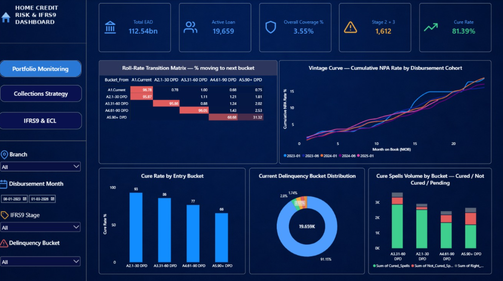
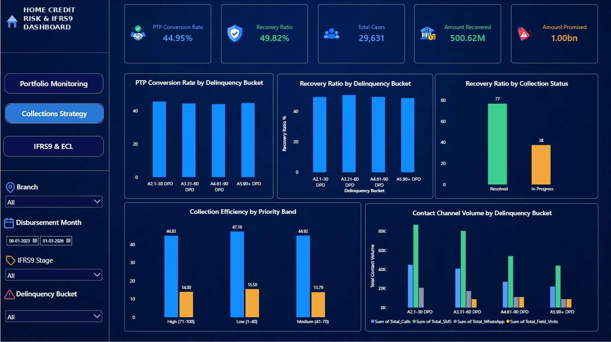
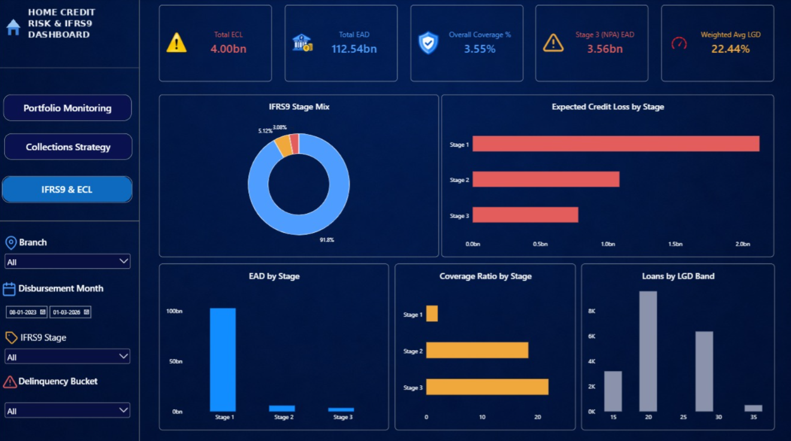

# Retail Home Loan Credit Risk: IFRS 9 ECL Analytics (SQL Server + SAS + Power BI)

An end-to-end credit risk analytics project on a retail home loan portfolio, covering portfolio performance monitoring, collections strategy and IFRS 9 Expected Credit Loss (ECL). It follows the full loan lifecycle from application to monthly performance and collections, for 19,659 disbursed home loans.

**Stack:** SQL Server (T-SQL) · SAS OnDemand for Academics · Power BI (DAX, Power Query)

---

## 1. Business Problem

Credit risk, collections and finance teams needed one governed view to answer:

- How do loans move between delinquency buckets month to month, and how many cure?
- How do loan cohorts (by disbursement month) age, and how fast do they turn non-performing?
- Which collections levers (channel, priority, delinquency severity) actually drive recovery?
- How much provision does the book need under IFRS 9, and how is it spread across Stage 1, 2 and 3?

## 2. Dashboard Pages

| Page | Focus |
|---|---|
| Portfolio Monitoring | Roll-rate matrix, vintage curves, cure rate by bucket, current delinquency mix |
| Collections Strategy | PTP conversion, recovery ratio, collection efficiency by priority band, contact channel volume |
| IFRS9 and ECL | Stage mix, ECL, EAD and coverage ratio by stage, loans by LGD band |

### Portfolio Monitoring


### Collections Strategy


### IFRS9 and ECL


## 3. Key Findings

| Area | Result |
|---|---|
| Portfolio | 19,659 disbursed loans, 112.54 Bn total EAD |
| IFRS 9 stage mix | Stage 1: 18,047 (91.8%), Stage 2: 1,006 (5.1%), Stage 3: 606 (3.1%) |
| Total ECL / coverage | 4.00 Bn, 3.55% overall coverage |
| Coverage by stage | Stage 1: 2.06%, Stage 2: 18.36%, Stage 3: 21.98% |
| Weighted average LGD | 22.44% |
| Macro adjustment factor | 0.9967 (Baseline 50%, Downside 30%, Upside 20%) |
| Roll rate | 96.78% of Current loans stay Current; 95.87% of 1-30 DPD loans roll back to Current |
| 90+ DPD behaviour | 68.68% move back to 61-90 DPD, 31.32% stay in 90+ DPD |
| Cure rate (3 consecutive months Current) | A2 93.1%, A3 85.9%, A4 76.7%, A5 65.7%, overall 81.4% |
| Vintage (2023-01 cohort) | 18.81% cumulative NPA by month 24 |
| Collections cases | 29,631; PTP conversion 44.95%; Escalated 55.05%, In Progress 30.95%, Resolved 14.01% |
| Recovery | 500.62M recovered against 1.00 Bn promised (49.82% recovery ratio) |

**Insights**

- Coverage rises with risk stage (2.06% to 18.36% to 21.98%), which is the behaviour IFRS 9 staging is meant to produce.
- Early delinquency mostly self-corrects: 1-30, 31-60 and 61-90 DPD loans most often roll back one bucket, and cure rates fall steadily as severity rises.
- PTP conversion is almost flat (about 44-47%) across delinquency bucket and priority band, so days past due is not what decides whether a customer promises to pay.
- Recovery ratio is the metric that separates outcomes: Resolved cases recovered about 77% of the promised amount against about 37% for In Progress cases.
- Escalated cases are exactly the cases where no promise to pay was made.

## 4. Recommendations

1. Put the heaviest collections effort on 61-90 and 90+ DPD, where cure rates are lowest, rather than on 1-30 DPD loans that mostly roll back on their own.
2. Track promise-to-pay follow-through (recovery ratio) as the lead collections KPI, since PTP conversion does not differentiate segments.
3. Review the priority score: it does not separate PTP or resolution rates, so segmentation needs a different driver.
4. Monitor the 1,006 Stage 2 loans, including restructured loans that are currently paying (Current bucket) but must stay in Stage 2.
5. Refresh collateral values over time so LGD reflects property price movement, not only loan amortization.
6. Adopt the dashboard as a monthly credit risk and provisioning review.

## 5. Data Model

SQL Server database `IFRS9_Project2` with `staging` (raw VARCHAR loads) and `dbo` (typed tables) schemas.

- **Source tables:** `customer_master`, `loan_application`, `income_employment`, `property_collateral`, `credit_bureau`, `document_fraud_verification`, `underwriting_decision`, `loan_disbursement`, `payment_transactions`, `monthly_loan_performance`, `collections_recovery`, `branch_master`, `product_master`, `macro_history`, `macro_scenarios`, plus a reference provisioning table that is not used as a model input.
- **Portfolio monitoring tables:** `roll_rate_transitions`, `roll_rate_matrix`, `vintage_loan_base`, `vintage_curve`, `cure_spells`, `cure_rate_summary`.
- **Collections tables:** `ptp_performance_detail`, `ptp_performance_summary`, `collection_efficiency_by_priority`, `collections_contact_summary`.
- **IFRS 9 tables:** `loan_current_status`, `ifrs9_stage_assignment`, `loan_ltv_lgd`, `loan_remaining_tenure`, `ifrs9_staging_export`, and from SAS `loan_ecl_final` and `ecl_summary_by_stage`.

**Power BI model:** `loan_disbursement` is the central loan table, linked to `loan_ecl_final` (one to one), `customer_master`, `cure_spells`, `ptp_performance_detail` and, through `loan_application`, to `branch_master`. Pre-aggregated summary tables stand alone.

### Methodology

- **Stage 3:** current Days_Past_Due of 90 or more
- **Stage 2:** not Stage 3, and (Days_Past_Due of 30 or more, or Restructured_Flag = 'Y')
- **Stage 1:** all other loans
- **LGD:** banded on current LTV (current outstanding balance / property market value): up to 60% gives 15%, 60-70% gives 20%, 70-80% gives 28%, above 80% gives 35%
- **PD:** Markov-chain propagation of the empirical roll-rate matrix, with 90+ DPD treated as absorbing for PD purposes only; 12-month PD for Stage 1 and remaining-tenure PD for Stage 2 and 3
- **Macro overlay:** probability-weighted factor from Baseline, Downside and Upside unemployment scenarios, applied to forward-looking PD for Stage 1 and 2
- **EAD:** current outstanding balance
- **Cure:** 3 consecutive months back in the Current bucket; spells without enough follow-up are excluded from the rate instead of counted as failures

### Data Scope Note

ECL is calculated for the 19,659 disbursed loans, out of 100,000 applications. Only the Home Loan product is populated. Monthly performance runs from February 2023 to September 2026. Property market value is captured once, at origination, so "current LTV" updates the loan balance but not the property value. PD is a roll-rate Markov-chain model, not a fitted scorecard on borrower characteristics, and macro scenarios and their probabilities are taken as supplied.

## 6. Bugs Found and Fixed

- **Duplicate month labels:** 6,807 loans had two different months-on-book sharing one Snapshot_Month label, which broke the intended primary key and silently loaded zero rows. Fixed by keying on (Loan_ID, MOB) and rebuilding the reporting date as Disbursement_Date + MOB months, with the original label kept and flagged.
- **Sticky NPA flag:** NPA_Flag never reverts to 'N' once set, so 1,638 loans that had fully cured still carried it. Using it for Stage 3 made Stage 3 larger than Stage 2 and pushed coverage to 5.39%. Fixed by staging on current Days_Past_Due only, giving a realistic stage mix and 3.55% coverage.
- **Silent BULK INSERT failure:** a moved source file left `customer_master` empty, and re-running without clearing staging created duplicate keys. Fixed by truncating staging before each load and reconciling row counts for all 16 tables.
- **Recursive CTE restriction:** a subquery inside the recursive member is not allowed in SQL Server; fixed by computing the bound into a variable first. Also cast `FORMAT()` output to `CHAR(7)` to remove an oversized index key.
- **SAS merge order:** every MERGE with BY needs sorted inputs; explicit sorts were added before each merge.
- **Wrong aggregation in Power BI:** summary-table charts defaulted to Count and showed identical bars; fixed by switching to Sum or Average.
- **Same field name in two tables:** a chart pulled `PTP_Conversion_Rate_Pct` from the wrong table and showed identical bars; fixed by rebinding to the correct table.

## 7. Repository Structure

```
ifrs9-home-loan-ecl-analytics/
├── README.md
├── sql/        # Phase 1 to 4C T-SQL scripts (staging, monitoring, collections, IFRS 9)
├── sas/        # Phase 4B: Markov-chain PD, macro overlay, ECL
├── data/       # 16 source CSV files (14 loan files + 2 macro files)
├── powerbi/    # .pbix file
└── images/     # dashboard screenshots
```

## 8. How to Run

1. Copy the files in `data/` to `C:\IFRS9_Project2\` (or change the path in the BULK INSERT statements). Run `sql/Phase1_Data_Staging.sql`, then Phase 2, Phase 3 and Phase 4A in order.
2. Export `dbo.ifrs9_staging_export` and the roll-rate matrix query (Section 6 of Phase 4A) to CSV. Upload them with `macro_history.csv` and `macro_scenarios.csv` to your SAS folder, set the `libname` path, and run `sas/Phase4B_SAS_PD_ECL.sas`.
3. Export `loan_ecl_final` and `ecl_summary_by_stage` from SAS to CSV and load them with `sql/Phase4C_Load_ECL_To_SQL.sql`.
4. Open `powerbi/` file and update the data source to your SQL Server instance.

## 9. Author

**Priyambada Rout** — Data Analyst, Bangalore
[LinkedIn](https://www.linkedin.com/in/priyambada-rout-571655190) · [Email](mailto:routpriyambada111@gmail.com)
